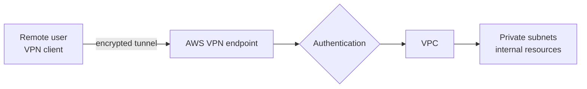

# AWS VPN with Terraform

> Infrastructure as Code project that designs and deploys a secure AWS environment with VPN access, integrated authentication services and fully automated provisioning.

 

---

## Objective

Provide **secure private access** to AWS resources through a VPN, and make the whole setup **repeatable and reviewable** with Terraform modules instead of manual console work.

---

## Architecture



---

## What it provides

- A **VPC** with the network layout needed for private resources
- A **VPN endpoint** giving users an encrypted tunnel into the environment
- **Authentication** integrated into the access flow, so only authorized users can connect
- **Automated provisioning**: the whole stack is created, changed and destroyed with Terraform

---

## Repository structure

```
.
├── environments/
│   └── dev/            # Root configuration of the dev environment
├── modules/            # Reusable Terraform modules
├── vpn-certs/          # Certificate material used by the VPN
└── .gitignore
```

Each module has a single responsibility, and each environment composes modules with its own variables. Adding another environment (for example staging) means adding a folder, not rewriting code.

---

## Deployment

**Prerequisites:** Terraform 1.5+, AWS CLI configured with a named profile, an AWS account.

```bash
git clone https://github.com/hiba05555/aws-vpn-iac-terraform.git
cd aws-vpn-iac-terraform/environments/dev

terraform init
terraform plan
terraform apply
```

**Clean up:** run `terraform destroy` when you are done. VPN endpoints are billed while they exist.

---

## Security notes

- Generate your own certificates locally. **Never commit private keys**; keep them out of version control.
- Terraform state files can contain sensitive values and must not be committed.
- Keep internal resources in private subnets and reach them only through the VPN.

---

## Design decisions

1. **Modules instead of copy-paste**: the same code is reused across environments.
2. **One folder per environment**: isolates the state and variables of each environment.
3. **Everything as code**: the environment can be rebuilt from scratch in one command and reviewed in a pull request.

---

## Contact

**Hiba Chagdaly**, Cybersecurity Engineering Student, ENSA Marrakech
GitHub: [@hiba05555](https://github.com/hiba05555) · [LinkedIn](https://www.linkedin.com/in/hiba-chagdaly-65922234a)
